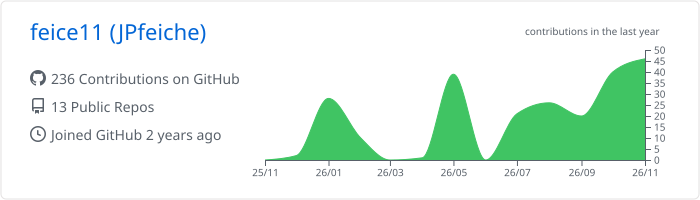
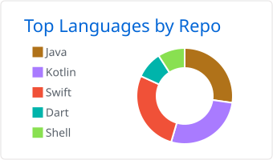
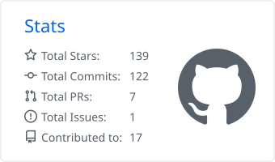

## Hi, I'm feice

I build Android UI and graphics things: Jetpack Compose components, AGSL shaders, HDR rendering, and the occasional system mod.

<picture>
  <source media="(prefers-color-scheme: dark)" srcset="https://skillicons.dev/icons?i=kotlin,androidstudio,cpp,rust,python,linux,git&theme=dark">
  
</picture>

### Projects

- [mochi-compose](https://github.com/feice11/mochi-compose): Jetpack Compose components with iOS-style motion, G2 continuous corners and an AGSL liquid glass. On Maven Central.
- [PiliPlus-SDR2HDR](https://github.com/feice11/PiliPlus-SDR2HDR): SDR to HDR video rendering for PiliPlus on Android, with tone-mapping controls.
- [Liftlock](https://github.com/feice11/Liftlock): Flyme-style lock screen lift-to-unlock motion as an LSPosed module.
- [WallXDR](https://github.com/feice11/WallXDR): ShaderEditor fork that renders HDR live wallpapers.

### Activity

<picture>
  <source media="(prefers-color-scheme: dark)" srcset="https://raw.githubusercontent.com/feice11/feice11/output/github-snake-dark.svg">
  
</picture>

<picture>
  <source media="(prefers-color-scheme: dark)" srcset="profile-summary-card-output/github_dark/0-profile-details.svg">
  
</picture>

<picture>
  <source media="(prefers-color-scheme: dark)" srcset="profile-summary-card-output/github_dark/1-repos-per-language.svg">
  
</picture>
<picture>
  <source media="(prefers-color-scheme: dark)" srcset="profile-summary-card-output/github_dark/3-stats.svg">
  
</picture>

If my work is useful to you, you can support it on [afdian](https://ifdian.net/a/feice).
